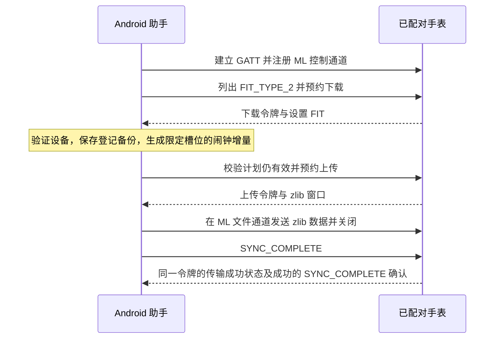

# Forerunner 255 原生闹钟的连接与传输

这是配对后的 Android BLE 设置同步流程，来自 Forerunner 255（产品编号 3992，固件 29.05）的实机研究。传给手表的是闹钟设置增量。课表留在手机上，手表按写入的时间和星期自行响铃。这条路径可以在 Android 应用中独立使用，调用入口是 [NativeAlarmClient.applyWeek](../android/cn/local/garminassistant/nativealarm/NativeAlarmClient.java)。

## 1. 建立两条逻辑通道

在工作线程通过 `BluetoothManager` 找到唯一一块已配对、名称为 `Forerunner 255` 的手表。调用 `connectGatt(..., TRANSPORT_LE)`，连接成功后发现服务。`BLUETOOTH_CONNECT` 由宿主申请。蓝牙名称用于候选筛选，设备身份在读取 FIT 后验证。

- Garmin GATT 服务 UUID 为 `6a4e2800-667b-11e3-949a-0800200c9a66`。首先使用短号为 `0x2811` 的接收特征和 `0x2821` 的发送特征，它们使用与服务相同的 UUID 模板。
- 读取接收特征的 CCCD。已经启用通知时保留该状态。否则启用并等描述符写入回执，再通过 ML（MultiLink）管理报文注册逻辑服务 `1`。注册响应 `status=0` 时保存分配的句柄。如果返回 `status=3` 并指定接收特征 `0x2810`，关闭本次连接后改用 `0x2810/0x2820` 重试一次。
- 服务 `1` 传 GFDI 控制消息。需要收发文件内容时，另行注册 ML 服务 `0x2018`，使用对方返回的文件句柄。当前代码要求文件通道返回 `reliable=0`。
- GFDI 控制帧使用小端长度、消息号、负载及 CRC，外层使用带零分隔符的 COBS。控制通道和文件通道每个 GATT 写入都以各自句柄起始，后面最多 19 字节。等待本次特征写入回调成功后再发下一片。文件通道承载文件传输控制字节和 zlib 数据。

连接、回调、句柄和订阅管理见 [NativeAlarmConnection.java](../android/cn/local/garminassistant/nativealarm/NativeAlarmConnection.java)，帧和压缩见 [GarminWire.java](../src/cn/local/garminassistant/nativealarm/GarminWire.java)。

## 2. 先读取设置，再生成增量

File Access V2 使用 GFDI 消息 `5043` 和 `5044` 承载请求和回复，`5000` 用于确认。V2 对应 Smart 消息的字段 `43`。下面的字段对表示该子消息内的请求与回复字段。

| 操作 | 字段对 | 需要核对的结果 |
|---|---|---|
| 列出设置文件 | `9 / 10` | 成功且恰好有一个 `FIT_TYPE_2` 条目；保留该条目的标识和大小 |
| 预约下载 | `1 / 2` | 成功状态、有效令牌、受支持的传输类型和 zlib 窗口 |
| 预约上传 | `3 / 4` | 成功状态、有效令牌、起始偏移为 0、受支持的传输类型和 zlib 窗口 |
| 取消预约 | `18 / 19` | 失败时仅取消本次申请到的令牌 |

预约下载后打开文件通道，把下载令牌放入文件请求。收到控制响应 `00 00 00` 后接收 zlib 数据。等文件通道成功关闭，再检查解压总长度、流边界、FIT 长度及 CRC。校验 Settings FIT 的设备编号和产品与用户登记的设备一致，首次登记时先原子保存备份。

使用登记备份生成新的 FIT 文件。增量包含 Connect 格式的 FileId 和授权槽位的闹钟记录（全局消息 `222`）。字段 `254` 是槽号，`0` 是当天分钟数，`1` 是星期掩码（周一从最低位开始），`2` 是启停。主闹钟和可选的备用闹钟共用有权限的槽位。启用槽沿用用户确认过的提示模板，其他槽位的记录不进入增量。

请求、回复和令牌处理见 [GarminFileAccess.java](../src/cn/local/garminassistant/nativealarm/GarminFileAccess.java)，解压检查见 [FitDownload.java](../src/cn/local/garminassistant/nativealarm/FitDownload.java)，增量构造与校验见 [NativeAlarmFit.java](../src/cn/local/garminassistant/nativealarm/NativeAlarmFit.java)。

## 3. 上传并确认生效

预约成功后，将令牌放在文件通道的上传控制报文里。收到 `00 00 00` 后按协商窗口封装 zlib，并分片发送增量。分片写入和文件通道关闭成功只表明数据送完。应用记录成功还需要同时满足两项条件。

1. File Access V2 的异步 Transfer Status 属于**本次上传令牌**。失败原因字段只要出现就算失败，值为 `0` 也代表失败。
2. `SYNC_COMPLETE`（GFDI `5030`）收到成功的 `5000` 确认。此确认和 Transfer Status 可以任意先后到达，二者都要等到。

超时、令牌不符或失败回执时不记为已同步。释放本次注册的句柄和 GATT 连接，恢复本次启用的通知订阅，保留原有的订阅状态。

## 4. 实机验收与已知区别

- 低层原型曾通过 GFDI 目录和下载读到设置，相关代码保留在 [GarminFileDiscovery.java](../src/cn/local/garminassistant/nativealarm/GarminFileDiscovery.java)。正式路径的下载与上传都使用 File Access V2。
- 配对、GATT 写入成功、文件关闭成功和手表接受设置是不同阶段。检查日志中的 `REGISTER_REDIRECT`、`V2_SETTINGS_LIST`、`V2_PULL`、`V2_PUSH`、`FILE_UPLOAD_CLOSE`、`V2_TRANSFER_STATUS` 和 `SYNC_COMPLETE`，按阶段定位故障。
- 蓝牙读到的 Settings FIT 可能滞后。回执用于确认本次写入流程完成，显示与响铃则在手表闹钟列表核对，必要时通过手表 USB 读回最新设置，并观察到点响铃。
- `python tools/run.py check` 可在离线环境运行合成 FIT 和模拟传输测试，覆盖两种回执顺序、错误令牌、缺回执以及失败原因字段为 `0` 的情况。
